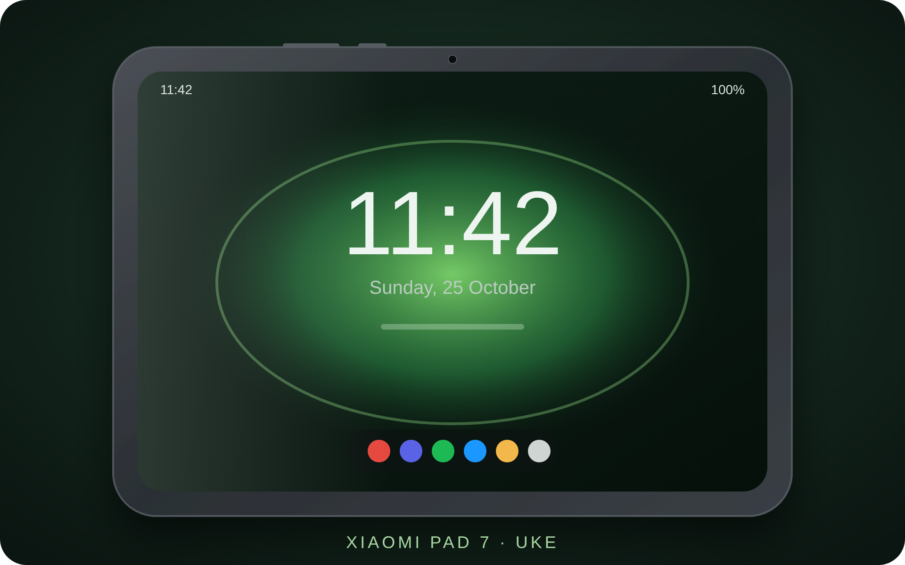

<h1 align="center">Xiaomi Pad 7 Development</h1>
<p align="center"><i>Open-source Android device trees for the Xiaomi Pad 7 &ldquo;<code>uke</code>&rdquo;</i></p>

<p align="center">
  
</p>

<p align="center">
  
  
  
  
</p>

---

## 📦 Repositories

| | Repository | Branch | What it is |
|---|---|---|---|
| 📱 | [`android_device_xiaomi_uke`](https://github.com/Xiaomi-Pad-7-Development/android_device_xiaomi_uke) | `sixteen` | Device tree |
| 🐧 | [`android_kernel_xiaomi_sm8635`](https://github.com/Xiaomi-Pad-7-Development/android_kernel_xiaomi_sm8635) | `sixteen` | Kernel source, built with the ROM |
| 🔒 | [`android_vendor_xiaomi_uke`](https://github.com/Xiaomi-Pad-7-Development/android_vendor_xiaomi_uke) | `sixteen` | Proprietary blobs, extracted from the stock uke ROM (large files via Git LFS) |

## 🛠️ Building

Clone the five repositories into your ROM checkout:

```sh
git clone https://github.com/Xiaomi-Pad-7-Development/android_device_xiaomi_uke                -b sixteen device/xiaomi/uke
git clone https://github.com/Xiaomi-Pad-7-Development/android_kernel_xiaomi_sm8635             -b sixteen kernel/xiaomi/sm8635
git clone https://github.com/Xiaomi-Pad-7-Development/android_kernel_xiaomi_sm8635-devicetrees -b sixteen kernel/xiaomi/sm8635-devicetrees
git clone https://github.com/Xiaomi-Pad-7-Development/android_kernel_xiaomi_sm8635-modules     -b sixteen kernel/xiaomi/sm8635-modules
git clone https://github.com/Xiaomi-Pad-7-Development/android_vendor_xiaomi_uke                -b sixteen vendor/xiaomi/uke
```

Keep the kernel repositories side by side under `kernel/xiaomi`, the kernel finds its device trees there. The vendor tree uses Git LFS, so run `git lfs install` before cloning it.

## 🎯 Goals

- One clean device tree per device, with a readable history
- Blobs taken only from the device's own stock ROM
- Original authors credited on every commit

---

<p align="center">Developed and led by <a href="https://github.com/delano-git"><b>delano-git</b></a></p>
