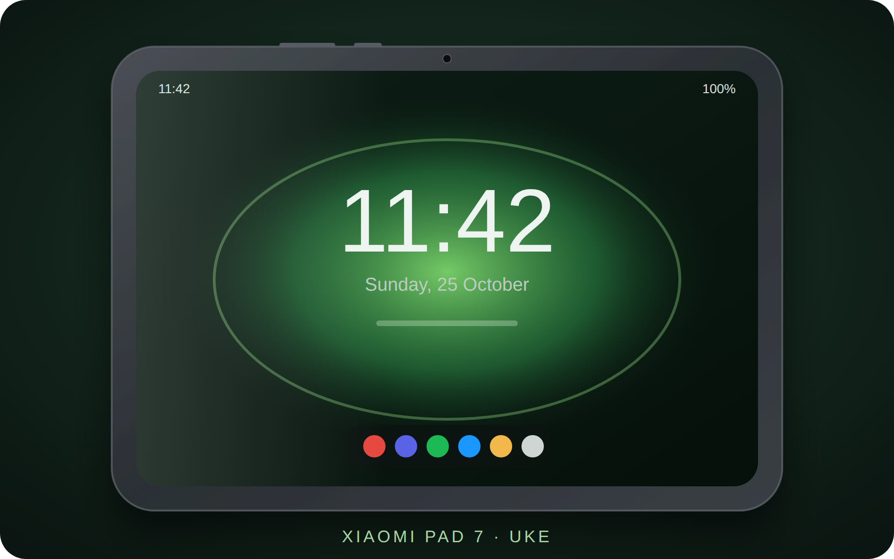

<h1 align="center">Xiaomi Pad 7 Development</h1>
<p align="center"><i>Open-source Android device trees for the Xiaomi Pad 7 &ldquo;<code>uke</code>&rdquo;</i></p>

<p align="center">
  
</p>

<p align="center">
  
  
  
  
</p>

---

## 📦 Repositories

| | Repository | Branch | What it is |
|---|---|---|---|
| 🧩 | [`android_device_xiaomi_uke`](https://github.com/Xiaomi-Pad-7-Development/android_device_xiaomi_uke) | `sixteen` | Device tree |
| 🐧 | [`android_device_xiaomi_uke-kernel`](https://github.com/Xiaomi-Pad-7-Development/android_device_xiaomi_uke-kernel) | `sixteen` | Prebuilt kernel, modules and DTBs |
| 🔒 | [`android_vendor_xiaomi_uke`](https://github.com/Xiaomi-Pad-7-Development/android_vendor_xiaomi_uke) | `sixteen` | Proprietary blobs, extracted from the stock uke ROM (large files via Git LFS) |

## 🛠️ Building

Clone the three repositories into your ROM checkout:

```sh
git clone https://github.com/Xiaomi-Pad-7-Development/android_device_xiaomi_uke        -b sixteen device/xiaomi/uke
git clone https://github.com/Xiaomi-Pad-7-Development/android_device_xiaomi_uke-kernel  -b sixteen device/xiaomi/uke-kernel
git clone https://github.com/Xiaomi-Pad-7-Development/android_vendor_xiaomi_uke         -b sixteen vendor/xiaomi/uke
```

The vendor tree uses Git LFS, so run `git lfs install` before cloning it.

## 🎯 Goals

- One clean device tree per device, with a readable history
- Blobs taken only from the device's own stock ROM
- Original authors credited on every commit

---

<p align="center">Developed and led by <a href="https://github.com/delano-git"><b>delano-git</b></a></p>
